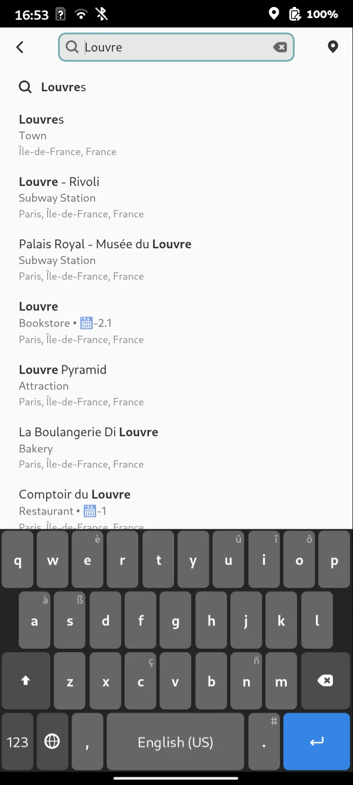
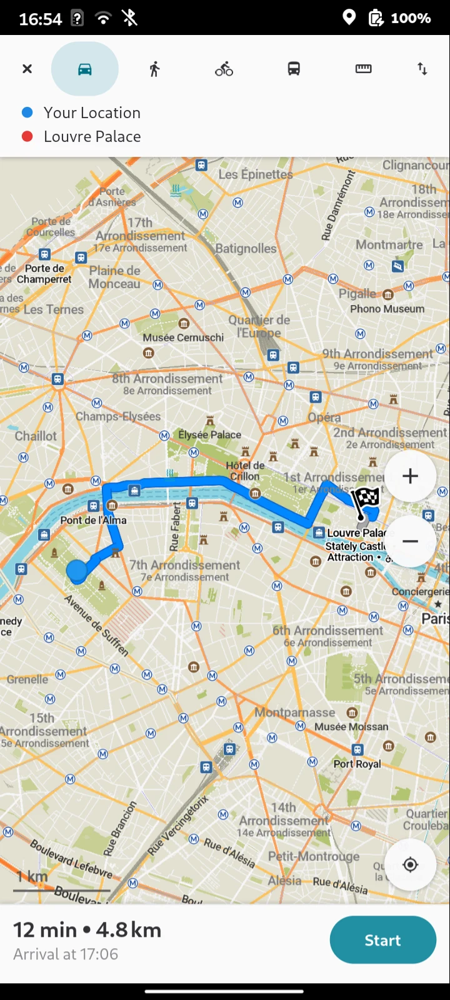
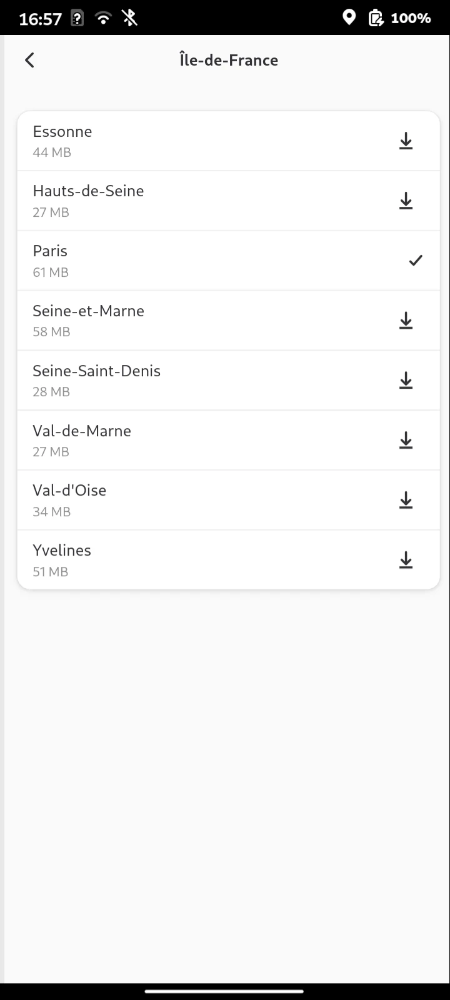
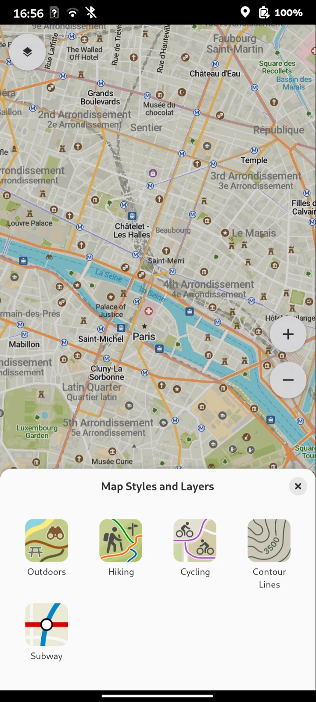
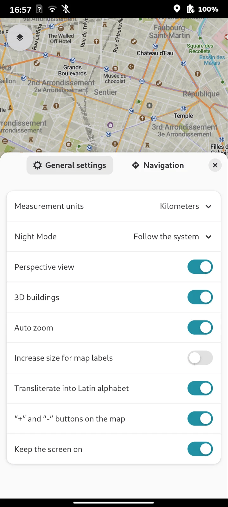

# Lichen

> **Branch `comaps-core-prototype`: Lichen Preview.** This branch is a feasibility prototype
> that replaces the Organic Maps core with the [CoMaps](https://www.comaps.app) core. It builds
> `lichen-devel` packages ("Lichen Preview", application ID `io.github.x_vlad_x.Lichen.Devel`)
> that install beside the regular Lichen and keep their data in `~/.local/share/CoMaps` and
> `~/.config/CoMaps`. Its packages are workflow artifacts, not releases; the decision to switch
> cores has not been made. The rest of this page describes Lichen as built on this branch.

An unofficial native GNOME interface (GTK4 + libadwaita) for offline maps, made for Linux phones.
The regular Lichen uses the [Organic Maps](https://organicmaps.app) core; this branch uses CoMaps. Previously published as "Organic Maps (GTK)"; releases up to 0.1.0-preview5
use that name and the `organicmaps-gtk` package name.
Developed and tested on the FuriLabs FLX1s with FuriOS (Phosh).
An x86_64 AppImage is also tested on CachyOS. Other systems need separate testing;
package dependencies and supported versions are documented in [packaging/README.md](packaging/README.md).

## Download

These are releases of the regular, Organic Maps based Lichen. The prototype from this branch is
only available from the "Packages" workflow runs.

**[Download 0.1.0-preview5](https://github.com/x-vlad-x/lichen/releases/tag/v0.1.0-preview5)**

DEB, RPM and AppImage are available for **both x86_64 and ARM64**.
Choose the format for your distribution and the architecture of your device.

| Format | x86_64 / amd64 | ARM64 / aarch64 | Intended system |
|:--|:--|:--|:--|
| DEB | [Download](https://github.com/x-vlad-x/lichen/releases/download/v0.1.0-preview5/organicmaps-gtk_0.1.0-preview5-1_amd64.deb) | [Download](https://github.com/x-vlad-x/lichen/releases/download/v0.1.0-preview5/organicmaps-gtk_0.1.0-preview5-1_arm64.deb) | Debian 13 amd64; FuriOS ARM64 |
| RPM | [Download](https://github.com/x-vlad-x/lichen/releases/download/v0.1.0-preview5/organicmaps-gtk-0.1.0-preview5-1.fc44.x86_64.rpm) | [Download](https://github.com/x-vlad-x/lichen/releases/download/v0.1.0-preview5/organicmaps-gtk-0.1.0-preview5-1.fc44.aarch64.rpm) | Fedora 44 |
| AppImage | [Download](https://github.com/x-vlad-x/lichen/releases/download/v0.1.0-preview5/OrganicMapsGtk-0.1.0-preview5-x86_64.AppImage) | [Download](https://github.com/x-vlad-x/lichen/releases/download/v0.1.0-preview5/OrganicMapsGtk-0.1.0-preview5-aarch64.AppImage) | glibc 2.41+ and OpenGL ES 3 |

See the [installation instructions](https://github.com/x-vlad-x/lichen/blob/v0.1.0-preview5/packaging/INSTALL.md) and
[release notes](https://github.com/x-vlad-x/lichen/releases/tag/v0.1.0-preview5)
for requirements, checksums and preview limitations. Both RPMs passed installation,
desktop icon and map-rendering checks in Fedora 44 containers. Earlier phone builds
were tested on FuriOS / FuriLabs FLX1s; the x86_64 AppImage was tested on CachyOS.
Sources, a rebuildable source RPM and license notices are available with the release.

## Interface

| | | | |
|:-:|:-:|:-:|:-:|
|  |  |  |  |
|  |  |  |  |

The core (map rendering, search, routing, map downloads, bookmarks) is the CoMaps code, unchanged
apart from a small build patch. The interface is new and follows the Android app:

- full-screen map rendered on the GPU (OpenGL ES 3 through GtkGLArea);
- Android-style touch gestures: drag, pinch, two-finger rotation, double tap, long tap (hides/shows
  the controls);
- bottom menu (Search / Route / Bookmarks and tracks / Menu), zoom and "My position" buttons;
- place page in a bottom sheet: type, address, opening hours ("Closed now • Opens at 10:00"), phone,
  website, Wikipedia, coordinates, Save / Route from / Route to / Share;
- search with categories, history, match highlighting and results on the map;
- routing: car, pedestrian, bicycle, public transport, ruler; intermediate stops, alternative routes,
  elevation profile; turn-by-turn navigation with lanes, speed limit, arrival time and voice guidance
  (espeak-ng, installed together with the app);
- map downloader: country tree, search, updates, "Download <region>" banner on the map;
- bookmarks and tracks: lists, bookmark editor (name, color, list, notes), KML/KMZ/GPX import,
  track recording;
- map modes (walking with hiking routes, cycling, driving, public transport) and the outdoors and
  contour line layers; night mode (the UI turns dark together with the map); settings as in the
  Android app;
- location through GeoClue, compass through iio-sensor-proxy;
- opens `geo:`, `cm://` and `comaps://` links and bookmark files.

The UI is translated into the languages of the CoMaps Android app: strings come from its Android
resources (`values-<locale>/strings.xml`), the language follows the system locale.

## Building and installing

Development builds provide DEB, RPM and AppImage for both x86_64 and ARM64.
Build recipes, source collection and release preparation are described in
[packaging/README.md](packaging/README.md).
The original SSH installation method remains available below.

Requirements on the build machine (x86_64 Linux): git, podman, ImageMagick, rsync, python3, ssh.
The phone must be reachable over SSH with key authentication.

```bash
./update-lichen.sh            # build the pinned CoMaps core and install Lichen Preview on the phone
./update-lichen.sh --ui-only  # quickly update only the program (after changes in gtk-ui/)
./update-lichen.sh --check    # what is installed on the phone, is there an update
./update-lichen.sh --build-only
./update-lichen.sh --uninstall [--purge]
```

The SSH destination is taken from `PHONE` (default `furios`), e.g. `PHONE=furios@192.168.1.10`.

The script fetches CoMaps at the commit pinned in `tools/core.env` into `core/`, prepares it with
`tools/prepare-core.sh` (submodules, build patch, world maps, generated styles and strings) and
cross-compiles for aarch64 in a Debian testing container (`build-env/`). The first build takes
about 20 minutes, later ones a couple of minutes. The result is in `out/`.

On the phone the program is installed to `~/.local/share/lichen-devel`, maps go to
`~/.local/share/CoMaps`, settings and bookmarks to `~/.config/CoMaps` (the same locations as the CoMaps Qt desktop
app). The regular Lichen and its `OrganicMaps` directories are not touched. No root access is needed.

## Project layout

- `gtk-ui/` — the interface, C++ on the plain GTK4/libadwaita C API: `map_view` (GtkGLArea and drape
  contexts on their own threads, touch input), `main_window`, `place_page`, `search`, `routing`,
  `downloader`, `bookmarks`, `settings`, `location` (GeoClue), `tts`, `l10n` (Android string resources);
- `gtk-ui/icons/` — icons converted from the Android app (`tools/vector2svg.py`);
- `patches/` — the build patch for CoMaps: hooks `gtk-ui/` into the CMake tree, links the bundled
  ICU, FreeType and HarfBuzz and takes the translated strings from the app instead of the stub;
- `tools/core.env` — the CoMaps repository and pinned commit; `tools/prepare-core.sh` prepares it;
- `build-env/` — container and CMake toolchain for cross-compilation;
- `packaging/` — launcher, desktop entry, icon (SVG source and a 512 px PNG rendered from it) and
  package recipes;
- `tools/` — helper scripts.

## Debugging

With `LICHEN_DEBUG=1` the app accepts commands over D-Bus, which is handy for testing on the phone
without touching it (see `gtk-ui/debug.cpp` for the command list):

```bash
gdbus call --session --dest io.github.x_vlad_x.Lichen.Devel --object-path /io/github/x_vlad_x/Lichen/Devel \
  --method org.gtk.Actions.Activate debug "[<'tap 200 400'>]" "{}"
```

## License

Apache License 2.0, see [LICENSE](LICENSE) and [NOTICE](NOTICE).

This project is not affiliated with or endorsed by CoMaps. This branch is based on
[CoMaps](https://www.comaps.app) code, translations and turn icons; the interface icons come from the
Organic Maps Android app and the Lichen application icon is original. Map data
© [OpenStreetMap contributors](https://www.openstreetmap.org/copyright).
